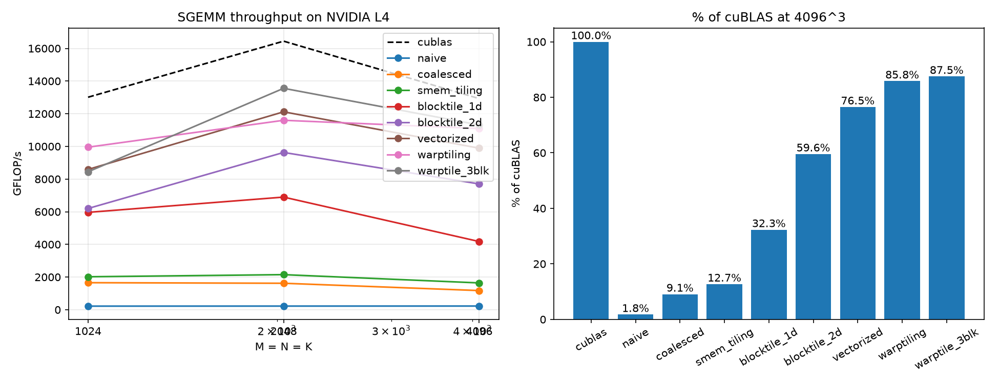

# nanoserve

An LLM inference engine where every performance-critical kernel is hand-written in CUDA C++:
GEMM, FlashAttention, paged attention, fused norms/RoPE, quantized GEMM and mixture-of-experts.
PyTorch is used only as a correctness reference. Every kernel ships with a benchmark against the
vendor library, a roofline position and an Nsight Compute explanation of where its time goes.

## Roadmap

| Phase | Deliverable | Baseline to beat | Status |
|---|---|---|---|
| 1 | SGEMM, naive → warptiled; then BF16 tensor-core GEMM (`mma.sync`) | cuBLAS | **done: 91% FP32, 90% BF16** |
| 2 | FlashAttention-2 forward (+ paged-attention decode: future) | standard attention; FlashAttention / SDPA in Phase 6 | **done: 67 TFLOP/s, up to 17.9x** |
| 3 | Fused RMSNorm+residual, RoPE, SwiGLU | eager PyTorch op sequence | **done: 98.5-99.7% of DRAM ceiling** |
| 4 | W4A16 GEMV (decode) + tensor-core GEMM (prefill); perplexity check in Phase 6 | cuBLAS BF16 | **done: 3.4-3.7x decode (M=1), 2.4-3.2x (M=8)** |
| 5 | MoE: fused top-k router + grouped GEMM with token permutation | PyTorch loop over experts | |
| 6 | Engine: run a real model end to end, tokens/s | llama.cpp, vLLM | next |
| 7 | Hopper port (TMA + WGMMA) of the best GEMM/attention kernel | cuBLAS / FA3 on H100 | |

## Phase 1 results: GEMM on an NVIDIA L4

All numbers are % of cuBLAS on the same GPU (median-of-runs to be added). FP32 cuBLAS runs in pedantic
mode (no TF32). The L4 is power-limited (72 W): under sustained load its SM clock dropped from
2040 to 1215 MHz, which is why everyone, cuBLAS included, slows down at 4096.

### FP32 (CUDA cores)

| # | Kernel | 1024 | 2048 | 4096 | Key idea / evidence |
|---|---|---|---|---|---|
| 1 | naive | 1.7% | 1.4% | 1.8% | uncoalesced: 98% memory, 12% compute (ncu) |
| 2 | coalesced | 12.7% | 9.9% | 9.1% | 8.3x from coalescing alone |
| 3 | smem_tiling | 15.5% | 13.1% | 12.7% | only 1.13x: bound by shared-memory loads (2 per FMA) |
| 4 | blocktile_1d | 45.8% | 41.9% | 32.3% | 8 outputs/thread: 3x at the same occupancy |
| 5 | blocktile_2d | 47.6% | 58.6% | 59.6% | 8x8 outputs/thread; wave quantization at 1024 (64 blocks, 58 SMs) |
| 6 | vectorized | 66.0% | 73.7% | 76.5% | SASS: compiler already used LDS.128 in k5; gain is LDG/STG.128 (4x fewer global ops) |
| 7 | warptiling | 76.5% | 70.5% | 85.8% | 16.7% occupancy, fastest kernel |
| 8 | warptile_3blk | 64.9% | 82.4% | 87.5% | register cap for 3 blocks/SM: wins at 2048 (2.21 -> 1.47 waves), small spill |

Best per size: **77-91% of cuBLAS** (run-to-run variance up to ~7%).



### BF16 tensor cores (FP32 accumulate)

cuBLAS: 54 / 75 / 75 TFLOP/s at 1024 / 2048 / 4096, about 4.6x its FP32 throughput.

| # | Kernel | 1024 | 2048 | 4096 | Key idea / evidence |
|---|---|---|---|---|---|
| 1 | wmma_naive | 23.2% | 15.7% | 10.4% | fragments straight from global memory |
| 2 | wmma_smem | 58.7% | 67.4% | 68.9% | SASS: WMMA smem loads compiled to 48 generic LD.E, no LDSM |
| 3 | wmma_async2 | 60.0% | 70.8% | 64.3% | cp.async double buffering (LDGSTS in SASS) |
| 3 | wmma_async3 | 50.1% | 61.1% | 56.2% | 3 stages = 57 KB smem -> 1 block/SM, slower |
| 4 | mma_w64x32 | 75.3% | 87.4% | 83.9% | ldmatrix + mma.sync: LDSM replaces LD.E |
| 4 | **mma_w64x64** | **76.0%** | **89.9%** | **87.3%** | 64x64 warp tiles, 231 regs, 0 spills: **67.5 TFLOP/s** |

## Phase 2 results: FlashAttention-2 forward on an NVIDIA L4

BF16 Q/K/V/O, FP32 softmax and accumulation, BH = 16 (batch x heads). Built on the Phase 1 primitives
(cp.async, ldmatrix, mma.sync): each warp keeps its Q fragments, running max/sum and 16 x D output
accumulator in registers; the score matrix goes from the S accumulator straight into P A-fragments and
never touches shared or global memory. Causal tiles above the diagonal are skipped per block and per warp.
Both variants pass a double-precision CPU check (max error ~3e-3, bf16 rounding).

Baseline: standard attention = cuBLAS GEMM (S = QK^T, fp32) + softmax kernel (P, bf16) + cuBLAS GEMM.
At N = 8192 it writes and re-reads 6.4 GB of S and P.

| D | causal | N=1024 | N=2048 | N=4096 | N=8192 | speedup at 8192 |
|---|---|---|---|---|---|---|
| 64 | no | 50.6 | 57.2 | 64.3 | 62.8 | 12.0x |
| 64 | yes | 36.7 | 43.3 | 51.6 | 54.7 | **17.9x** |
| 128 | no | 49.4 | 59.5 | **67.1** | 61.0 | 6.0x |
| 128 | yes | 38.6 | 50.2 | 56.1 | 59.5 | 9.9x |

TFLOP/s of the faster variant (useful work only; causal counts half). 67.1 TFLOP/s is about 89% of
cuBLAS's best BF16 GEMM on this GPU.

**Variant 1** (64 query rows, 4 warps, 64-key tiles) vs **variant 2** (128 rows, 8 warps; 32-key tiles
for D=128): at D=128, v1 needs 87 KB of smem, so one 4-warp block per SM. v2 fits 8 warps in 70 KB and
serves each K/V tile to twice as many queries: **+30% at D=128** (51.8 -> 67.1 TFLOP/s). v1 still wins
for N <= 1024, where 128-row blocks leave too few blocks for 58 SMs (wave quantization again).

## Phase 3 results: fused memory-bound ops on an NVIDIA L4

Memory-bound ops are judged by bandwidth, not FLOP/s. Ceiling: a 16-byte copy kernel reaches
**237 GB/s** on this L4 (the datasheet says 300). Baselines mirror the eager op sequence of HF Llama,
one vectorized kernel per op. Llama-3-8B shapes: H = 4096, 32 Q / 8 KV heads, D = 128, I = 14336.

T = 16384 tokens (every footprint far exceeds the 48 MB L2, so this measures DRAM):

| Op | Eager kernels | Eager | Fused | Speedup | Predicted (bytes eager / fused) | Fused % of ceiling |
|---|---|---|---|---|---|---|
| residual add + RMSNorm | 5 (fp32 temporaries) | 8.40 ms | 2.27 ms | **3.70x** | 30 / 8 = 3.75x | **99.7%** |
| RoPE on Q and K | 8 (4 per tensor + cos/sin tables) | 6.48 ms | 1.42 ms | **4.55x** | ~18 / 4 | **99.4%** |
| SwiGLU | 2 | 10.01 ms | 6.03 ms | **1.66x** | 10 / 6 = 1.67x | **98.5%** |

For memory-bound ops, speedup = bytes the eager sequence moves / bytes the fused kernel moves, and the
measurements match the byte counts almost exactly; the fused kernels sit at the hardware limit.
Fused RoPE is also 4x more accurate than eager (max error 3e-3 vs 1.3e-2): it computes sin/cos in fp32
instead of reading bf16-rounded tables. At small T the data fits in L2 and "bandwidth" exceeds DRAM
(up to 782% of the ceiling); the benchmark flags those rows.

## Phase 4 results: W4A16 quantized linear layers on an NVIDIA L4

Weights: 4-bit, group-wise symmetric (group 128 along K, one bf16 scale per group, w = (q - 8) * s),
0.516 bytes per weight vs 2 for bf16. Activations bf16, accumulation fp32. Llama-3-8B layer shapes.
Weights rotate through ~200 MB of copies so every timed run streams from DRAM, not L2.

**Decode, 1 token (GEMV, memory-bound):**

| Layer (N x K) | cuBLAS bf16 | W4 GEMV | Speedup | W4 GB/s (% of copy ceiling) |
|---|---|---|---|---|
| qkv 6144x4096 | 0.201 ms | 0.057 ms | **3.52x** | 227 (96%) |
| o 4096x4096 | 0.136 ms | 0.040 ms | **3.43x** | 219 (93%) |
| gate_up 28672x4096 | 0.899 ms | 0.242 ms | **3.71x** | 250 (106%) |
| down 4096x14336 | 0.454 ms | 0.126 ms | **3.62x** | 242 (102%) |

Ideal: 2 / 0.516 = 3.9x. Over 100%: the copy-kernel ceiling is half writes; a read-only stream runs
slightly faster (a read-only bandwidth test is on the to-do list).

**Decode, 8 tokens (batched decode): a profiler-driven fix.**

| Layer | cuBLAS bf16 | W4, 1 row/warp | W4, 4 rows/warp | Speedup (final) | % of ceiling (final) |
|---|---|---|---|---|---|
| qkv | 0.205 ms | 0.127 ms | 0.071 ms | **2.87x** | 78% |
| o | 0.136 ms | 0.093 ms | 0.056 ms | **2.44x** | 67% |
| gate_up | 0.946 ms | 0.671 ms | 0.299 ms | **3.16x** | 87% |
| down | 0.472 ms | 0.373 ms | 0.178 ms | **2.66x** | 73% |

The first version gave only 1.3-1.6x at M = 8 while cuBLAS time stayed flat from M = 1 to 8, so the GEMV
had stopped being memory-bound. Nsight Compute: **L1/TEX 89%, DRAM 38%, compute 33%**: L1-bound, from
every warp re-reading X for its single output row. Fix: each warp computes 4 rows and reuses each X chunk
4 times. After: **L1/TEX 41%, DRAM 55%**, and 2x faster. Nothing is saturated now, which points to
latency: 194 registers/thread leave one 8-warp block per SM, too few loads in flight (next lever).

**Prefill (M = 512-2048):** 49-80% of cuBLAS bf16 (best 52.4 TFLOP/s). Each K tile takes an extra smem
round trip (packed -> dequantized bf16 tile -> ldmatrix) and an extra barrier; Marlin-style kernels
dequantize straight into registers from pre-shuffled weights. 4-bit weights save memory, not compute,
so large prefill batches can stay on bf16 kernels.

Correctness: exact match to a CPU reference on the dequantized weights (max error 1e-7 GEMV, 2e-3 GEMM).
Quantization error on random uniform weights: 7.05% (pessimistic; real-model perplexity in Phase 6).

## Quickstart (AWS)

1. Request GPU quota: Service Quotas → EC2 → "Running On-Demand G and VT instances" → 4 or 8 vCPUs.
2. Launch `g6.xlarge` (NVIDIA L4, sm_89) with the **Deep Learning Base AMI with Single CUDA (Ubuntu 24.04)** (x86), 100 GB gp3.
3. On the instance:

```bash
git clone https://github.com/Uttaprexa/nanoserve.git && cd nanoserve
./scripts/setup_ec2.sh          # then `sudo reboot` once for profiler permissions
make                            # builds all benchmarks; prints registers/spills per kernel
./build/bench_sgemm             # FP32: correctness + GFLOP/s vs cuBLAS -> results/*.csv
./build/bench_hgemm             # BF16 tensor cores vs cuBLAS
./build/bench_attn              # FlashAttention vs standard attention (+ CPU correctness check)
./build/bench_fused             # fused RMSNorm / RoPE / SwiGLU vs eager, GB/s vs copy ceiling
./build/bench_w4a16             # 4-bit GEMV (decode) and GEMM (prefill) vs cuBLAS bf16
make sass                       # load widths (LDS/LDSM) and HMMA counts per kernel
```

**Stop the instance when you're done.** A stopped instance only bills for its disk.

## Profiling

```bash
# Full Nsight Compute report for one kernel; open the .ncu-rep in the Nsight Compute GUI locally
ncu --set full -k regex:hgemm_mma -c 1 -o results/mma_4096 ./build/bench_hgemm --only 6 4096

# Waves, occupancy and registers
ncu --section LaunchStats --section Occupancy -k regex:sgemm_warptiling -c 1 ./build/bench_sgemm --only 7 2048
```

## Layout

```
include/common.cuh          error checks, CUDA-event timer
kernels/sgemm/NN_*.cuh      FP32 kernels, numbered in optimization order
kernels/hgemm/NN_*.cuh      BF16 tensor-core kernels; ptx.cuh wraps cp.async, ldmatrix, mma.sync
kernels/attn/               FlashAttention-2 forward + standard-attention baseline
kernels/fused/              fused residual+RMSNorm, RoPE, SwiGLU + eager baselines
kernels/quant/              W4A16 GEMV + tensor-core GEMM with in-smem dequantization
bench/bench_*.cu            correctness vs cuBLAS / CPU reference + timing + CSV
scripts/                    EC2 setup, build helper, plotting
results/                    CSVs, plots, ncu reports
docs/LOG.md                 worklog: what changed, what ncu said, what I learned
```
